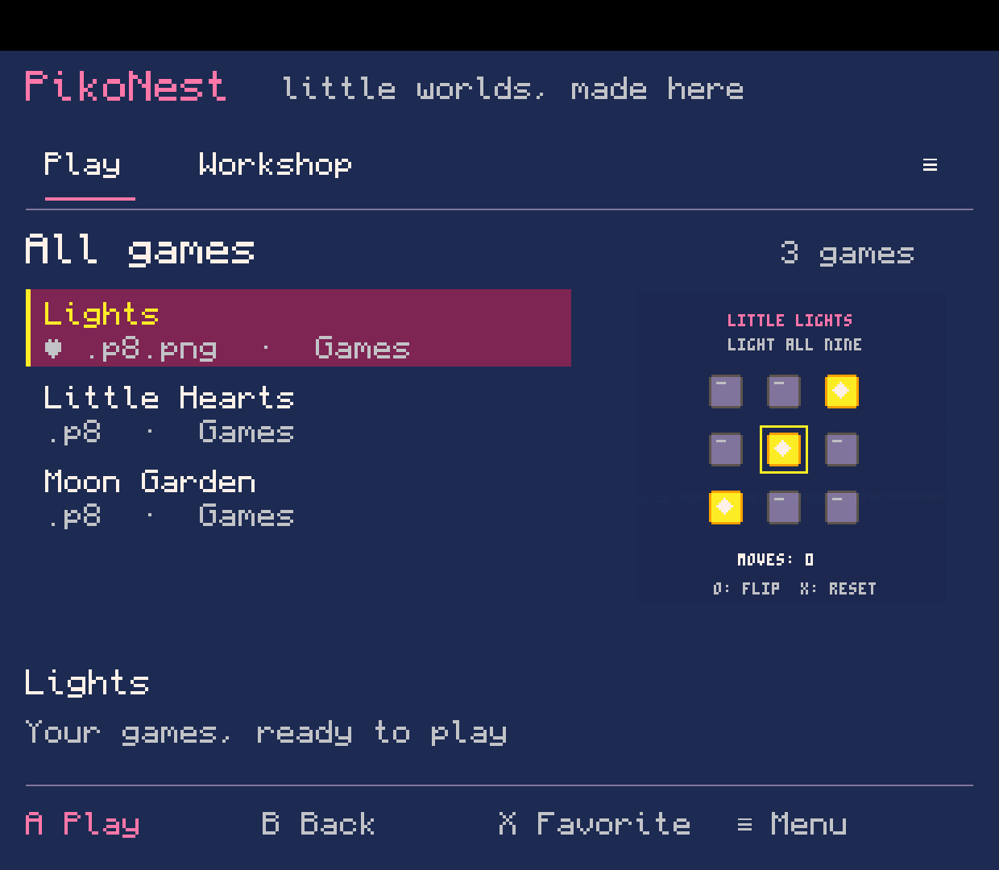
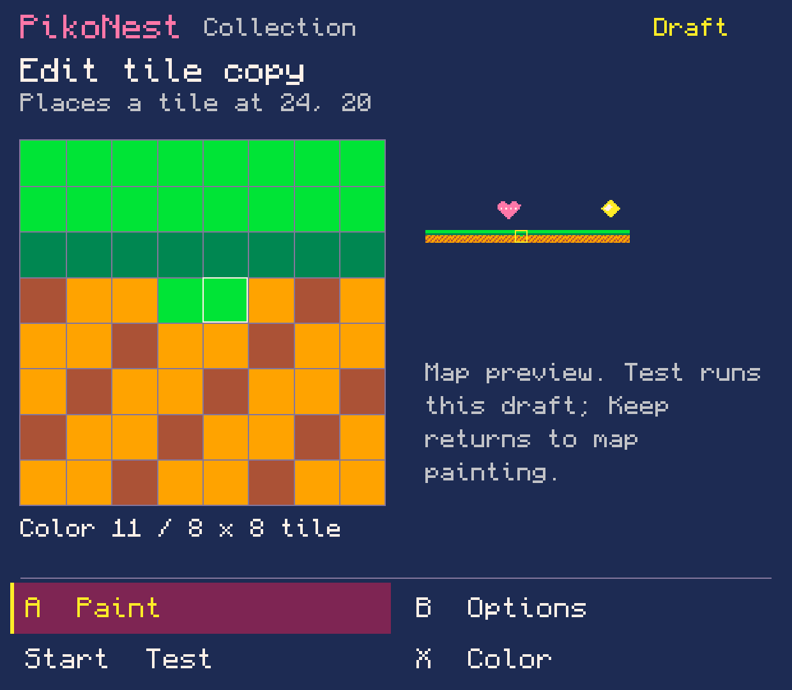
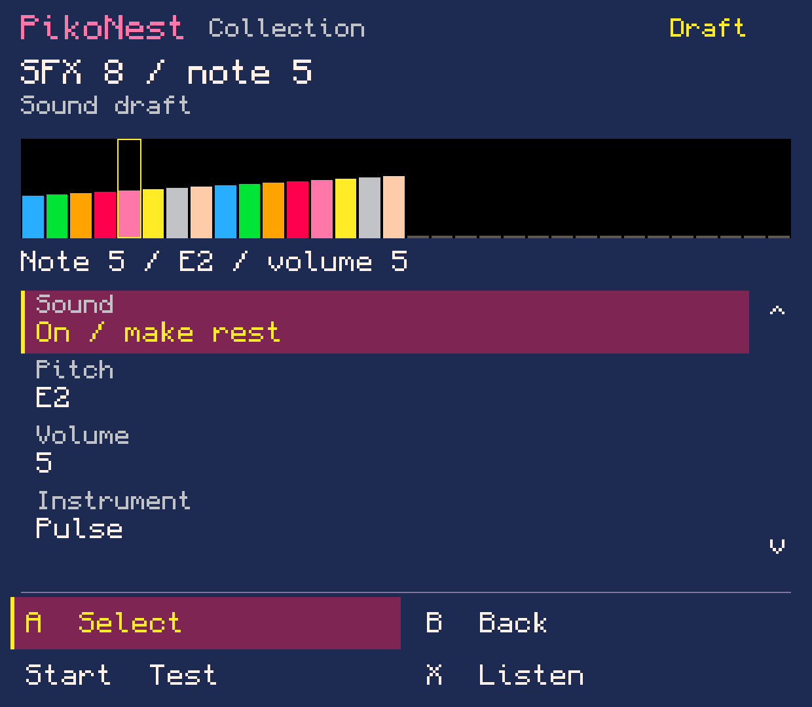
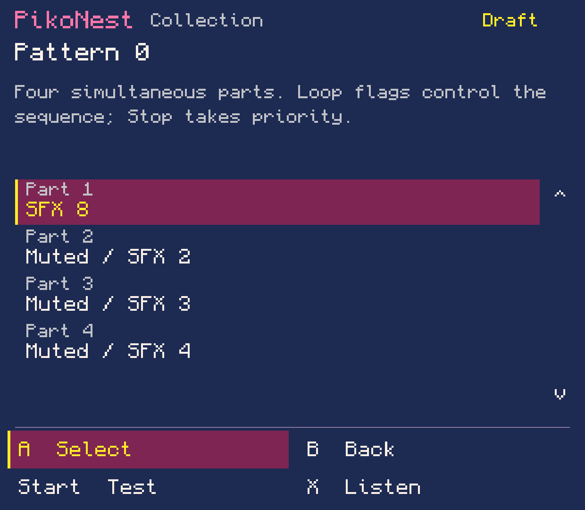

# PikoNest

**A tiny PICO-8 home and game-making workshop for Android handhelds.**

Play a little game. Change something. Make something of your own.
PikoNest brings **Play, Workshop and runtime setup into one APK**, with physical
controls at the center of the experience. You supply your purchased official
PICO-8 runtime; it is never bundled with the app.

**Preparing the first early beta — no public APK release yet.** The intended
candidate is `0.1.0-beta.1`. More ambitious gameplay can still require Lua.
[Early beta scope](docs/BETA_SCOPE.md) · [Preparation and remaining gates](docs/release/beta1/README.md)

[Project status](PROJECT_STATUS.md) · [Changelog](CHANGELOG.md) ·
[Roadmap](docs/ROADMAP.md) · [Build and contribute](CONTRIBUTING.md) ·
[Image gallery](docs/showcase/README.md)

## Play when you want to play

Browse your cartridges, keep favorites and return to your shelf after a game.
Playing does not require a project, an import into the editor or a tutorial.
Third-party Android launchers can hand games to PikoNest too.

The latest source adds **Splore → Play**: open the official browser, download games,
then find the cached cartridges on the same shelf after returning. Their labels,
available titles, favorites and recent launches stay connected to persistent runtime
data. This path is locally tested; real downloading, return and offline playback
still need the candidate's device check. [Splore details](docs/SPLORE.md).

*Historical Android capture, lab 0.0.66. It is not a screenshot of the new beta candidate.*

## A workshop that fits in your hands

Start from Blank or a small editable example. Select something in Game view to
change its artwork or behavior, paint the world around it, and try it in PICO-8.
The same general tools remain available in every project; a template is a starting
point, not a lock on what you can make.

**Fresh pictures below are host-rendered previews of current production UI with
configured demo data, not Android screenshots or gameplay proof.** Native captures
will be updated after the handheld is available for testing.

<table>
<tr>
<td></td>
<td></td>
</tr>
<tr><td>Choose an element and shape your game.</td><td>Paint tiles directly from the world workflow.</td></tr>
<tr>
<td></td>
<td></td>
</tr>
<tr><td>Make and edit sound effects.</td><td>Arrange music and its shared sound resources.</td></tr>
</table>

Current tools cover bounded sprite/map editing, animation, cameras, backgrounds,
rules, sound and music. The connected Game view supports small collection and
switch games, world/tile work and associated animation/audio. Some broader tools
remain separate, and arbitrary Lua cannot be safely converted into visual controls.
[Implemented scope and limits](docs/STATUS.md).

## Real cartridges underneath

Projects remain ordinary **`.p8` cartridges** with standard PICO-8 Lua and data.
Optional workshop metadata lives alongside them; a finished game does not require
PikoNest's asset library to run. Test uses the user's official PICO-8 engine.
Unsupported editing should preserve source and explain the limit.

You can save reusable sprites and tool settings, organize categories/favorites,
and keep projects and the library in independently selected folders. More reusable
resource types and complete no-Lua workflows for additional genres are still planned.

[Two native Blank-to-game demonstrations from lab 0.0.77](docs/showcase/0.0.77-en/README.md)
remain the last complete device creation evidence. Later local implementation is
not a substitute for updated controller, runtime and novice acceptance.

## Getting started with the candidate

- One APK, one PikoNest icon. Existing technical package IDs remain unchanged.
- ARM64 Android runtime backend; minimum Android 8 / API 26, interim target SDK 28.
  These requirements do not mean every Android device has been tested.
- Import your purchased **Raspberry Pi PICO-8 ZIP containing `pico8_64` (ARM64)**.
  ZIP names and version numbers can vary. Desktop x86/Windows/macOS and ARM32-only
  archives are unsupported. Import checks structure; explicit Test checks execution.
- Choose Games and creation folders through the guide, or start with internal
  storage. Android's system picker may require touch on some devices.
- Keep updates in place. Use the new checked backup ZIP before uninstall/reset;
  projects, reusable assets, persisted drafts/settings and runtime saves/downloads
  are covered. Android restore/provider acceptance is still pending.

[Setup, supported scope and acceptance checklist](docs/release/beta1/README.md) ·
[Backup and recovery](docs/BACKUP_RESTORE.md) · [Local candidate build](experiments/android-integrated/README.md)

## What still needs finishing

The early beta is not published. Current candidate device checks, update/restore,
physical controls and owner review remain open. Native dependency notices and exact
matching-source provenance also remain a [distribution blocker](docs/release/beta1/DEPENDENCIES.md).

Full no-code creation across genres, modern Android targeting, broader asset reuse,
external Splore-folder synchronization and complete localization are later work.
Main shelves, setup and Game view are English; some legacy tools/help are not yet
fully translated. Linux handhelds and online experiments come later.

[Download the fresh preview image pack](docs/showcase/0.0.93-en/pikonest-early-beta-previews.zip)
with its [captions and provenance](docs/showcase/0.0.93-en/README.md).

Original PikoNest code uses the [MIT License](LICENSE). Fonts, runtime-wrapper
components and other dependencies retain their [separate terms](THIRD_PARTY_NOTICES.md).
PICO-8 belongs to Lexaloffle Games and is purchased separately. PikoNest is an
independent project. Third-party cartridges and extracted assets retain their
authors' terms.
