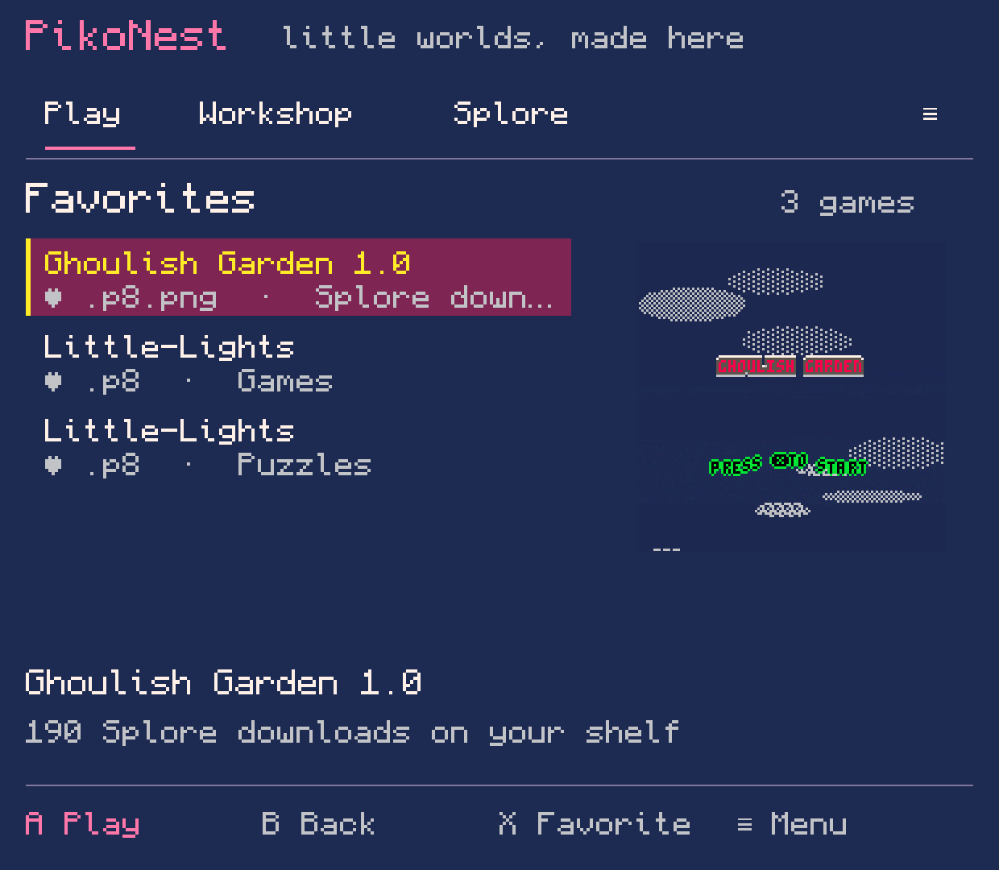
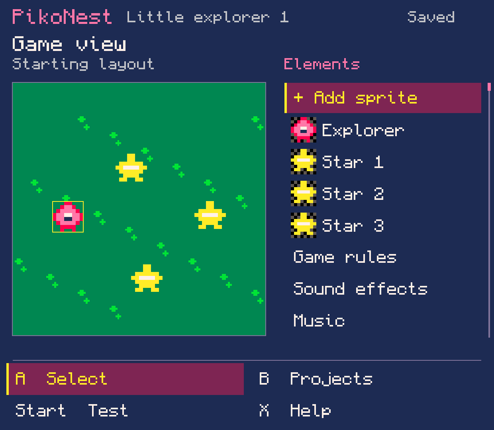
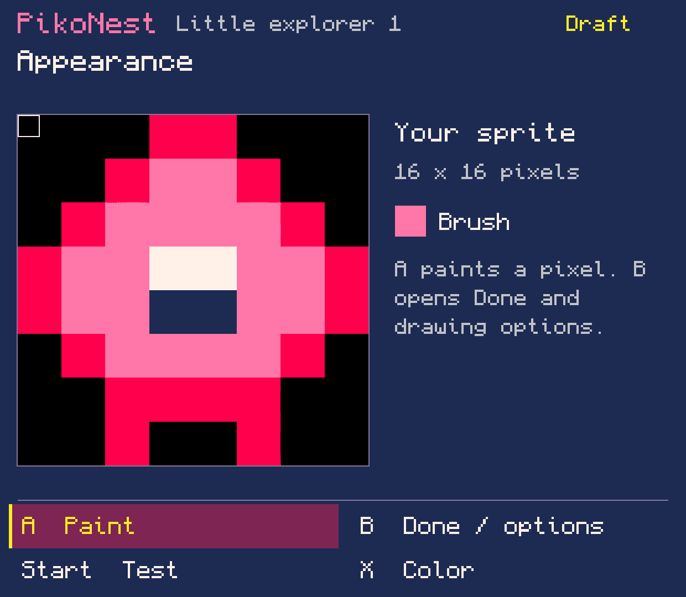
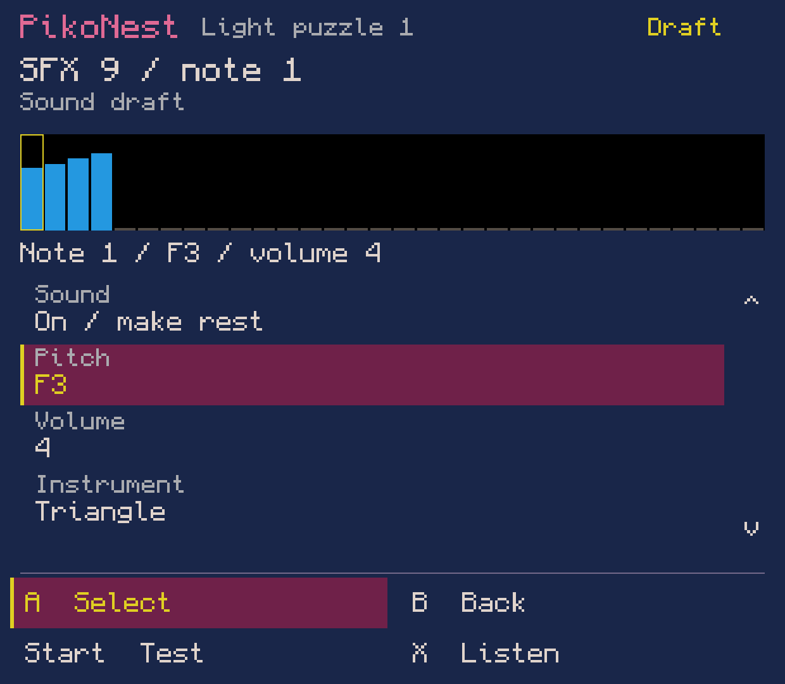
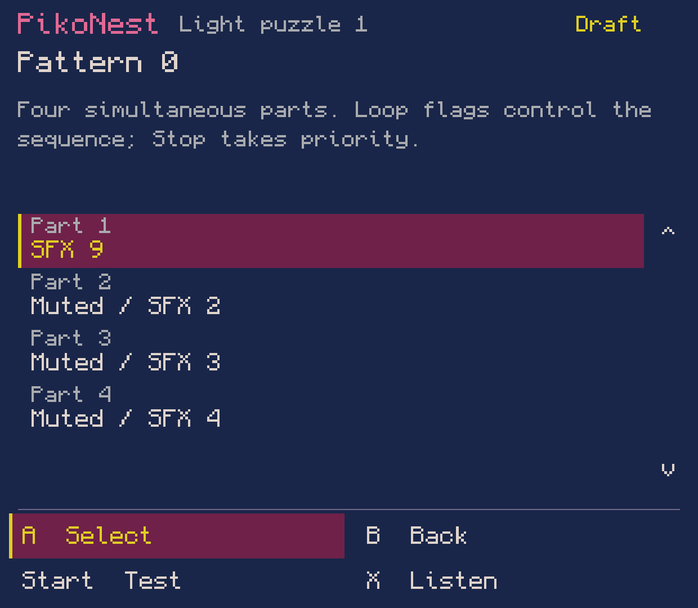
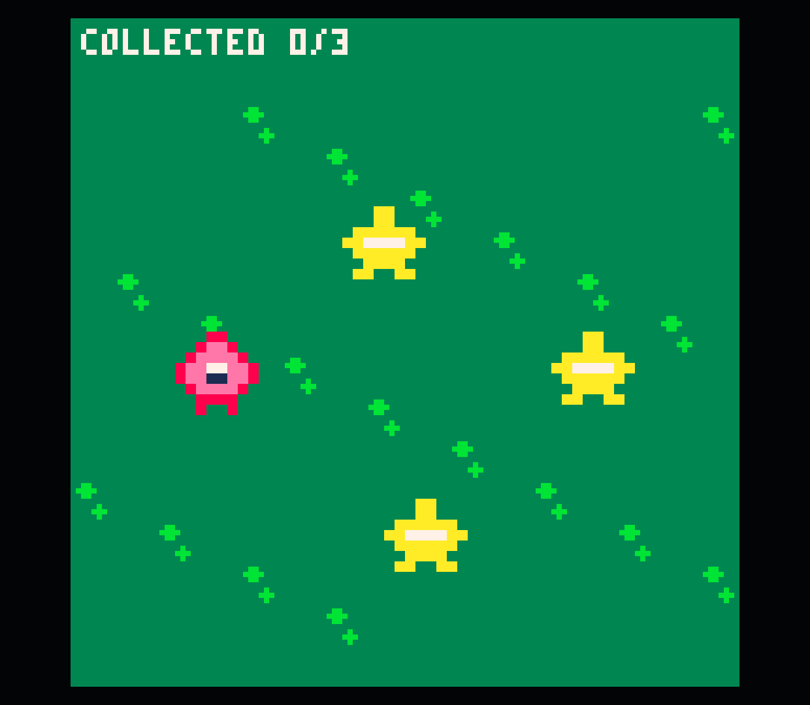
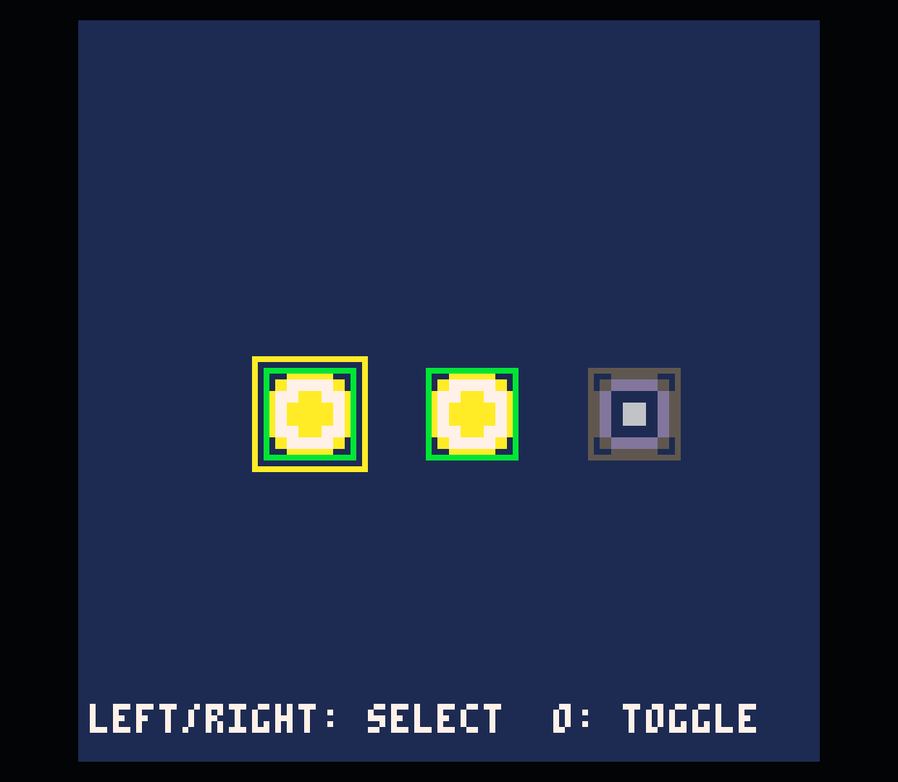

# PikoNest

**Little worlds, made here. A PICO-8 home and game-making workshop for Android handhelds.**

Play a little game. Change something. Make something of your own.
PikoNest brings **Play, Workshop and runtime setup into one APK**, built around
handheld controls and the PICO-8 palette. You supply your purchased official
PICO-8 runtime; it is never bundled with the app.

**[Download the first early beta — 0.1.0-beta.1](https://github.com/EriArk/PikoNest/releases/tag/v0.1.0-beta.1).**
One APK, checked on Retroid Pocket Classic. More ambitious gameplay can still
require Lua. [Tested scope and limits](docs/release/beta1/DEVICE_ACCEPTANCE.md).

[Project status](PROJECT_STATUS.md) · [Changelog](CHANGELOG.md) ·
[Roadmap](docs/ROADMAP.md) · [Build and contribute](CONTRIBUTING.md) ·
[Screenshots](docs/showcase/beta1-en/README.md)

## Play when you want to play

Browse cartridges, keep favorites and return to your shelf after a game. Playing
does not require a Workshop project or a tutorial. Third-party Android launchers
can hand games to PikoNest through its external launch interface.

Open **Splore**, discover a game, then find its downloaded cartridge on Play.
Available titles, cover art, favorites and recent launches stay connected to the
persistent runtime cache. Download → shelf → favorite → offline launch was checked
on the Retroid. Multicart continuation still needs separate validation.
[Splore details](docs/SPLORE.md).

*Actual Android capture. Featured cartridge: Ghoulish Garden 1.0 by Pixelody;
third-party artwork retains its author's terms.*

## A workshop that fits in your hands

Start from **Blank**, **Little explorer**, or **Light puzzle**. Choose an element
in Game view, change its sprite or behavior, paint its surroundings, and try the
result in official PICO-8. Templates supply editable starting content; the same
general tools remain available in every project.

<table>
<tr>
<td></td>
<td></td>
</tr>
<tr><td>Choose what you want to change.</td><td>Give it a little personality.</td></tr>
<tr>
<td></td>
<td></td>
</tr>
<tr><td>Shape sound effects, note by note.</td><td>Arrange shared phrases into music.</td></tr>
<tr>
<td></td>
<td></td>
</tr>
<tr><td>Try a tiny collection game.</td><td>Or make a puzzle without a hero.</td></tr>
</table>

*All pictures above are unmodified captures from the current Android candidate,
not mockups. [Captions, provenance and downloadable PNG pack](docs/showcase/beta1-en/README.md).*

The workshop includes sprite/map editing, animation, cameras, backgrounds, rules,
sound and music. Game view connects a supported subset into small games. Broader
tools remain available through **All tools**; custom Lua cannot automatically
be converted into visual controls. [Implemented scope](docs/STATUS.md).

## Real cartridges underneath

Projects remain ordinary **`.p8` cartridges** with standard PICO-8 Lua and data.
Optional workshop metadata lives alongside them. Exported games do not require
PikoNest's external asset library. Test runs the user's official PICO-8 engine.
Unsupported edits preserve source and explain their limits.

Reusable sprites and tool settings have categories and favorites. Projects and
the asset library can use separate locations. A checked backup ZIP covers active
projects, reusable assets, persisted drafts/settings and runtime saves/downloads.
Clean-project backup/restore has passed on Android; interrupted/provider-failure
journeys remain open. [Backup guide](docs/BACKUP_RESTORE.md).

## Getting started

1. Download the APK from the [GitHub release](https://github.com/EriArk/PikoNest/releases/tag/v0.1.0-beta.1). Update an existing installation
   **in place**; do not uninstall it to update. There is one PikoNest icon and no
   separate helper app.
2. Import your purchased **PICO-8 Raspberry Pi ZIP containing `pico8_64` (ARM64)**.
   Get it from your Lexaloffle purchase page. Windows/macOS/Linux x86 and ARM32-only
   archives are unsupported. ZIP names, enclosing folders and version numbers can
   vary; compatibility is checked from contents. Use **Test** after preparation.
3. Choose a Games folder, or skip it for now. Keep creation data internal initially
   or activate selected project/library folders. Android's system picker may need touch.
4. Enter Play to play, or Workshop to create. Save a backup outside the app before
   uninstalling or resetting it. Purchased runtime files and Android grants must
   be restored separately.

**Requirements:** ARM64 Android, minimum Android 8 / API 26; interim target SDK 28.
The current device check covers Retroid Pocket Classic / Android 14 / PICO-8 0.2.7.
It does not establish compatibility with every handheld or older/future runtime.
[Setup and candidate checklist](docs/release/beta1/README.md).

## An early workshop, with room to grow

Some gameplay still needs Lua. Complete no-code workflows across genres, broader
asset reuse, modern Android targeting, external Splore-folder synchronization and
full localization are later work. Main shelves/setup/Game view are English; some
legacy tools and help are not fully translated. Linux and online experiments come later.

Physical-controller ergonomics, audible playback, novice testing, broader device
coverage and storage-failure scenarios remain separate acceptance work. Sound was
muted during the latest automated device checks. [Evidence](docs/release/beta1/DEVICE_ACCEPTANCE.md).

Original PikoNest code uses the [MIT License](LICENSE). Dependencies retain their
[separate terms](THIRD_PARTY_NOTICES.md); matching support sources and rebuild
instructions accompany the release download. [Dependency record](docs/release/beta1/DEPENDENCIES.md).
PICO-8 belongs to Lexaloffle Games and is purchased separately. PikoNest is an
independent project. Third-party games and extracted assets retain their authors' terms.
