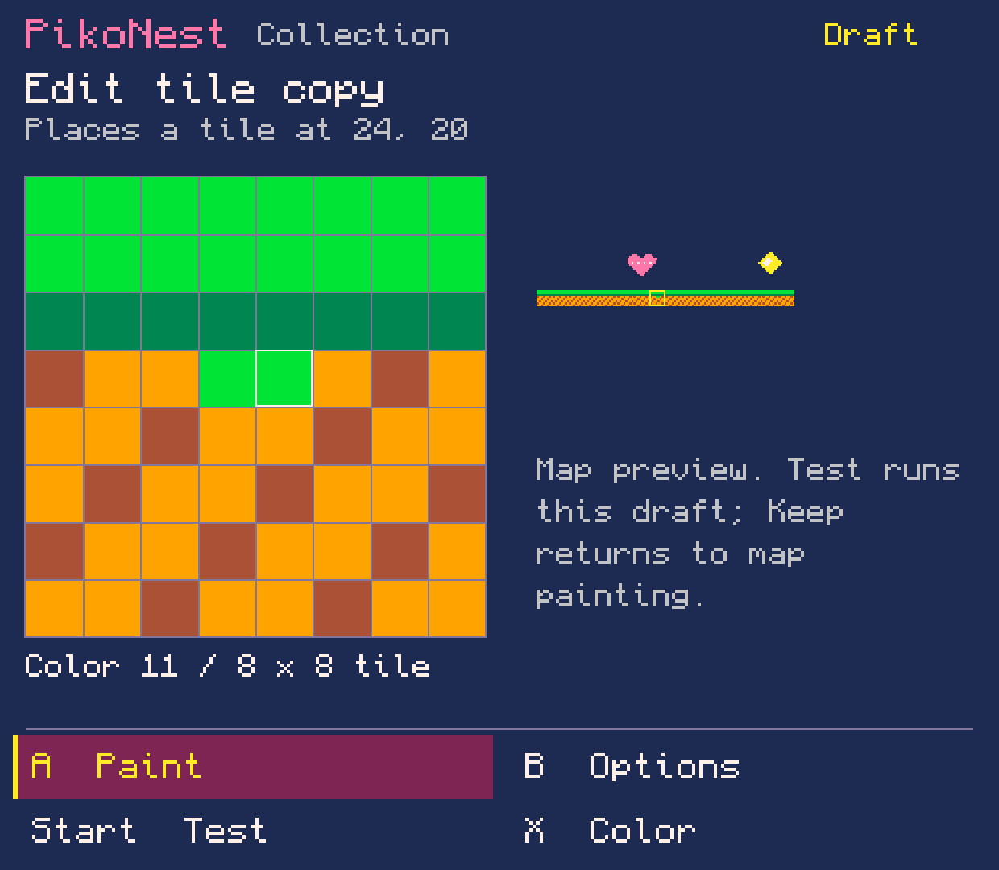
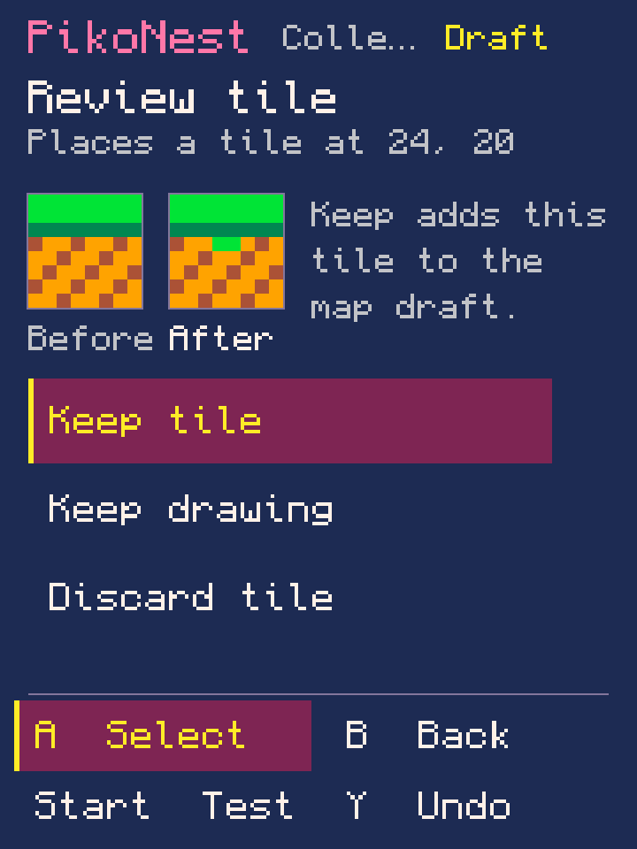

# Lab 0.0.85 — draw tile art inside the map

An **implementation/local-validation record**. Console use remains paused: no
installation, new official-runtime execution or native screenshots occurred.
No public APK release was created. [Workflow guide](../../WORLD_EDITOR.md).

## Implemented path

From Paint map, create an 8×8 tile, draw with controller actions or touch strokes,
choose colors/eraser, review before/after and keep it in the selected cell as the
current brush. No sprite placement or mandatory hero is created. Keep adds the
tile to the world draft; Save commits tile pixels, flags, map cells and camera
settings together. Test can run the nested tile draft without saving it.

Existing tiles offer use counts and an explicit edit-all or independent-copy
choice. Copies preserve flags and change only the selected cell. Hidden map
references, objects, animation frames, flags and nonzero pixels reserve storage.
Lower/shared tiles can be copied into upper storage without changing shared data;
in-place lower edits use the existing All tools consequence workflow.

Palette/menu/review, pixel cursor, local history and interrupted strokes recover.
A stroke is one tile Undo step; Keep is one world Undo step; Save is one session
Undo step. Discard leaves no orphan resource. Test and kept candidates use the
same resource serialization, including when sections did not exist in Blank.

## Actual validation

- **83 local core suite invocations** and the integrated Android APK build passed.
  Package checks retain one launcher, 263 required Godot assets and no official
  PICO-8 binaries. The local-only APK hash is in [validation.json](validation.json).
- **TileWorkflowTest: 33,004 assertions** across LF/CRLF. Covers controller
  painting/palette/eraser, isolated Test, interrupted-stroke recovery, local and
  world Undo/Redo, allocation/discard, multiple pending tiles, failed-save retry,
  exact session Save/Undo, shared references, flags, hidden map reservations,
  lower-memory preservation, audio/animation retention and bounded histories.
  Most repeated assertions compare protected pixels, not separate user journeys.
- WorldWorkflowTest: 16,496; GameCanvas: 16,504; GameAnimation: 80,199;
  GameRelationships: 81; GameIdentity: 101; GameRulesOverview: 100;
  SfxData: 2,222; SoundWorkflow: 200; MusicData: 548; MusicWorkflow: 218.
- Actual **v9** picker and active-field journals were generated with the previous
  lab's compiled classes. Six checks cover exact recovery, Undo/Redo, field revert
  and reserialization. Current journal is v10; earlier readers remain in place.
- Production GameSurface drawing was rendered through temporary Java2D adapters
  at 360×480, 360×800, 620×540 and 960×540 logical sizes. Compact labels were
  shortened after review. These are approximate host layouts, not native/device
  or physical-controller acceptance. No new runtime execution was used to
  validate resource copying; official compatibility acceptance remains open.

The committed TileWorkflowTest is included in the normal local build. It accepts
an optional output directory for created/independent/shared ordinary `.p8` test
fixtures. They are generated host fixtures, not native-authored export evidence.

## Host layout previews — not device screenshots

These use production drawing code and Monocraft through temporary host adapters.
The scene combines the project's own lab-0.0.77 collection art with an original
grass test tile. Two pixels are changed to make the before/after visible. Keep
this provenance when using them for a post; they do not document handheld use.

## Remaining scope and next work

Automatic tile allocation is limited to upper slots 1–127 in recognized Game view
projects. Tile zero follows the default empty-map convention. This is an 8×8 tile
workflow, not a limit on sprite size. New/copied tiles need visible pixels before
Test/Keep. Map painting remains upper 32 rows at one map origin; broader region,
fill and shared-memory editing stays in All tools. Collision, door transitions,
parallax, broader reuse and advanced audio remain unfinished.

Next connect two small editable starter journeys through the same general tools.
When console use is authorized, prove tile drawing, world/camera, audio/animation,
recovery, Test/return and independent exports on the device, then complete novice
and owner review. Issue #17 remains open. [0.0.77](../0.0.77-en/README.md) is still
the last complete native creation journey. Public APK publication needs separate
owner approval.
