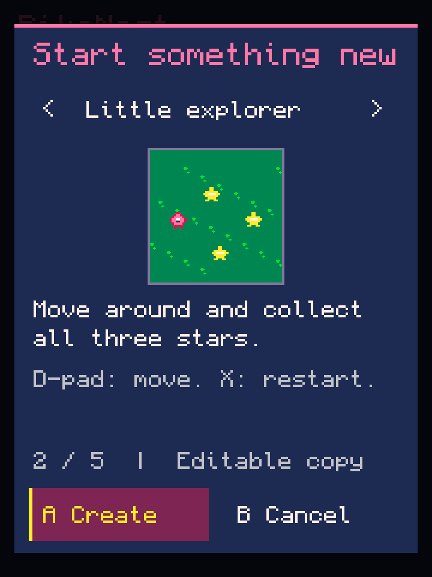
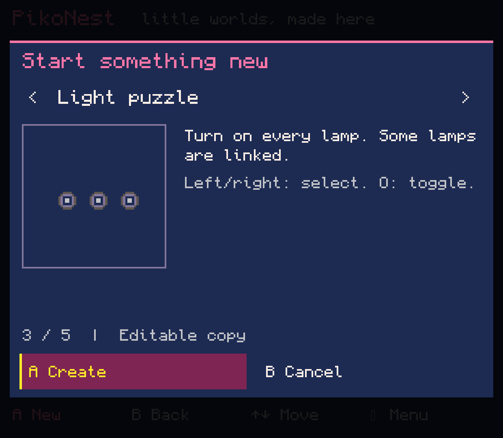
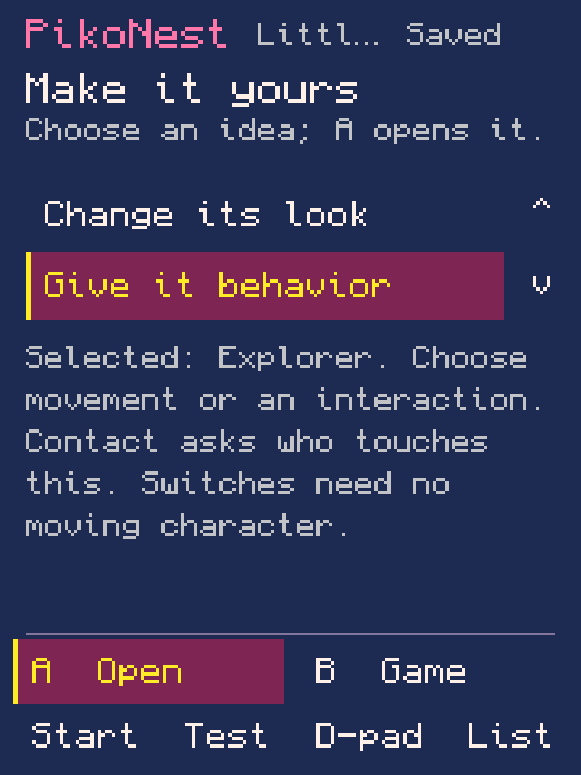

# Lab 0.0.86 — editable starts and contextual help

**Local implementation and validation only.** No device actions, installation,
new official-runtime execution or native screenshots occurred. Console use remains
paused. This is not a public APK release. [Workflow guide](../../STARTER_GAMES.md).

## What changed

The new-project dialog defaults to Blank and adds Little explorer and Light puzzle
with original art, starting-layout previews, plain descriptions and controls.
Both are ordinary editable `.p8` files generated through the same general model
used by Blank. New projects use exclusive IDs; previous examples/projects remain.

Little explorer connects movement, three collectibles, scenery, event sounds,
win and restart. Light puzzle connects three linked switches, on-state animation,
sounds, win and restart without a moving character. These are bounded examples,
not new genre-specific tools or proof of a complete no-code creator.

X / Help opens optional explanations and direct routes to existing editors.
Blank offers missing-element setup; unfamiliar Lua goes to All tools. Help is
source-checked and recoverable without modifying the cart. Existing Home row
indices remain stable; the new help row is appended. Current journal is v11.

## Validation

- **84 local core suite invocations** and the integrated Android build passed.
  One launcher, 263 required Godot assets and absence of official PICO-8 binaries
  were checked. A final unknown-layout help-return correction passed the focused
  starter suite, then Android compilation/packaging was refreshed without repeating
  all core suites. Final local APK hash is in [validation.json](validation.json).
- **StarterWorkflowTest: 135 assertions** in the final focused run (133 in the
  preceding full run). Covers default/cancel/confirmation, distinct IDs, source
  preservation, fresh copies, supported models, hero-free rules, shared appearance
  edit/recovery/Save/Undo/Redo, map/audio/music/goal tool routes, exact export/reopen,
  help recovery, missing-element setup, custom-source protection and failed create.
- Existing suites include LibraryWorkflow 31, HeroFree 100, GameCanvas 16,504,
  GameAnimation 80,199, WorldWorkflow 16,496 and TileWorkflow 33,004 assertions.
  Repeated pixel comparisons are not separate end-to-end journeys.
- **15 host Lua checks** run the actual generated scripts with Lupa, `+=`
  normalization and stubbed PICO graphics/audio. The explorer collects all stars
  through directional movement; both games reach win and restart. Checks include
  linked toggles, held-button edges, bright animation frames and event SFX calls.
  These do not prove official rendering, timing, audio or physical input.
- Actual v10 Home/Projects and interrupted-tile-stroke journals, produced by the
  prior lab's compiled classes, passed four recovery checks including Undo and
  v11 reserialization. Earlier version readers remain available.
- Production LibraryView/ShelfSurface/GameSurface drawing was inspected through
  temporary Java2D Android adapters at 360×480, 360×800, 620×540 and 960×540 logical
  sizes. Art size and compact labels were adjusted after review. These are host
  previews, not native screenshots or owner acceptance.

The normal local build runs StarterWorkflowTest. Its optional output directory
produces the exact factory-generated [Little explorer](little-explorer.p8) and
[Light puzzle](light-puzzle.p8) carts included here. They contain original project
art and ordinary Lua/data; these are host-generated fixtures, not UI-authored
native export evidence. No purchased runtime is included.

## Host previews — not device captures

Production UI calls, rendered with Monocraft through temporary host adapters.
The pixel art was authored in StarterGames for this batch. Keep this provenance
when using images for the website or a post.

## Remaining acceptance and next block

New-project creation, editing, Test/return, recovery, export, physical controls,
compact/wide layouts, official execution and novice/owner journeys still need
device acceptance. Issue #17 remains open; 0.0.77 is still the last complete native
creation journey. Learning progress, a broad genre catalogue and remaining general
tool/library work are unfinished. Next connect independent first-run setup and
recoverable storage/runtime preparation. Public APK publication remains a separate
owner gate.
