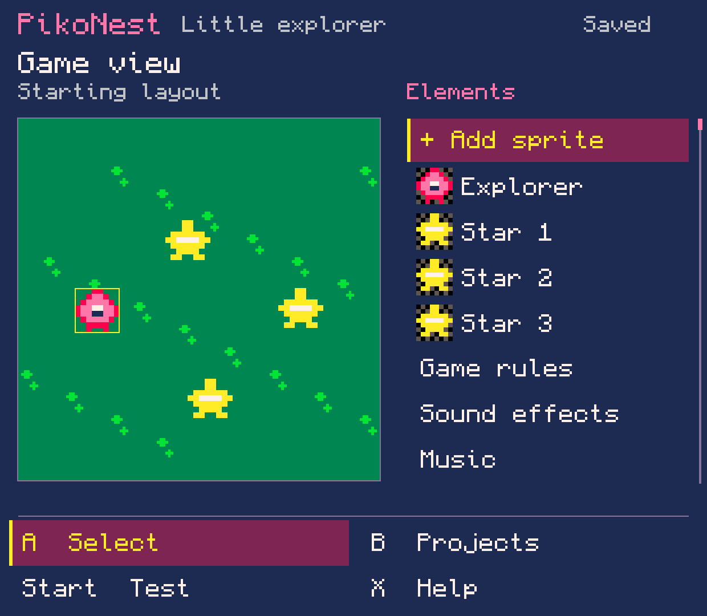
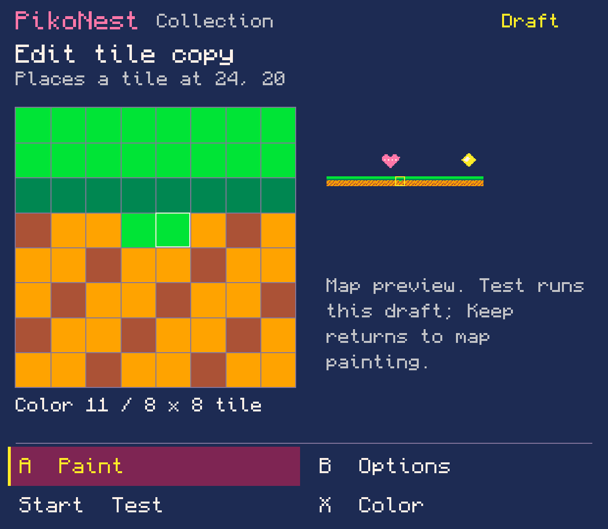
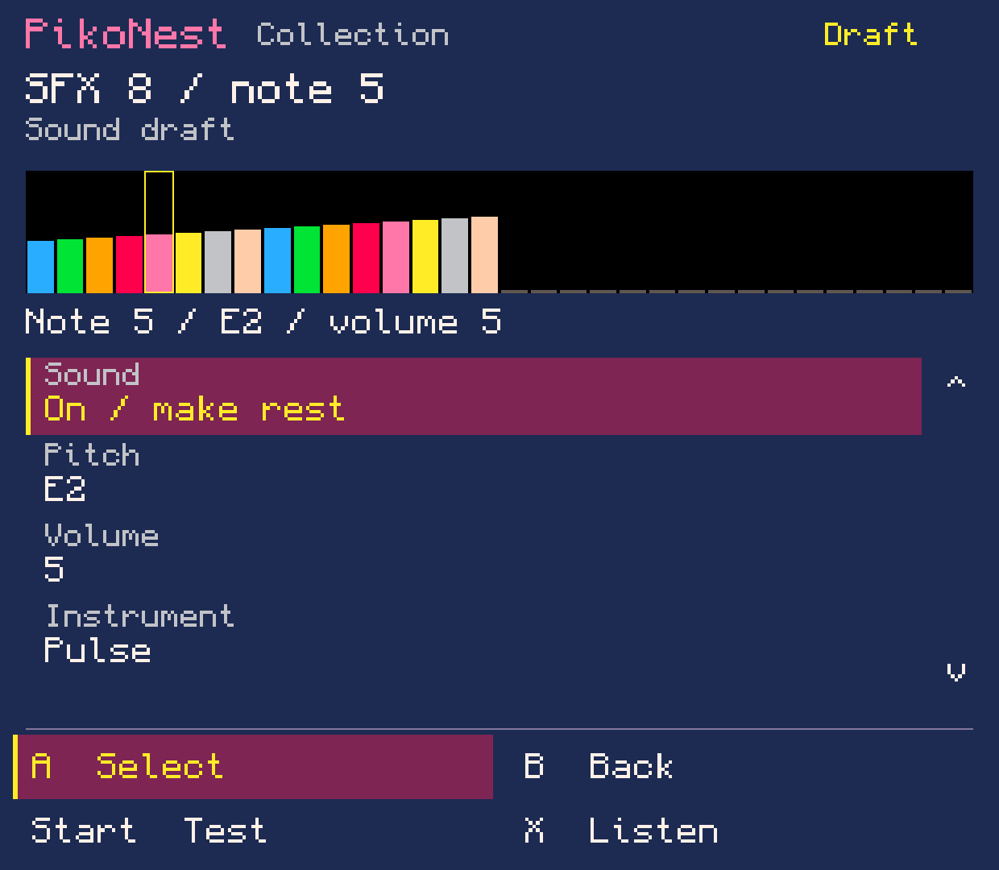

# Early beta preparation — source lab 0.0.93

2 November 2026. Candidate `0.1.0-beta.1`, version code 93. **No public release.**
The owner requested no handheld use; there was no ADB connection, device install,
runtime/network exercise or new native screenshot in this batch.

## Changes

- Checked ZIP backup of active projects/library, persisted drafts/settings and
  runtime saves/downloads. Restore stages and verifies data before confirmation,
  retains previous private versions and supports interrupted apply/rollback.
- Cold-start recovery prevents normal editing until the transaction finishes;
  explicit close/reopen steps reload Android preferences. Source conflicts and
  old AtomicFile sidecars are handled without overwriting unknown changes.
- Official Splore entry in Play, including an empty shelf. Its persistent BBS cache
  joins the Play list after runtime return and at normal opening/refresh, with
  cartridge labels, available names, favorites and recents. Download launch uses
  the existing runtime home, preserving cache files and related downloaded parts.
- Candidate packaging disables debugging and preserves the existing certificate,
  package ID and one-launcher layout. Purchased PICO-8 stays absent from the APK.
- README, setup/recovery instructions, draft release notes, acceptance checklist
  and dependency inventory are prepared. Distribution source provenance remains
  unresolved; this is a real publication blocker, not completed paperwork.

## Local verification

The final integrated beta build passed (exit 0), including all 91 core suites.
Its signature, one launcher, SDK 26/28, disabled debugging, 263 indexed Godot assets,
77 native inventory hashes and absence of official PICO-8 payload were verified.
The exact APK and signer hashes are recorded in [candidate.json](candidate.json).
Tests cover portable data/editor behavior; they do not exercise Android document
providers or official runtime execution. The 90-suite pre-cache build passed;
`BackupTest` has 154 assertions and the updated Play workflow 16,415. The new cache
suite checks local PNG/title discovery, stable IDs, preserved original bytes,
malformed/missing/partial files, unsafe paths and cancellation (16 checks).
The final source build includes all 91 suite invocations.

Backup tests include a real unfinished world draft restored against its archived
cart, all persisted preference types, source mutation and failure after each rename
for both completion and rollback. Native provider I/O timing, process death/power
loss, both restart steps and owner-data acceptance remain open.

## Fresh website pictures

These are **host-rendered previews**, generated from the current production Java
View/Surface code through [the tracked Java2D harness](../../../experiments/host-preview/README.md).
They show configured original PikoNest example content. They are not Android
screenshots, downloads from BBS or proof of gameplay/audio. Use that caption when
posting. The previous genuine Android captures remain separately attributed.

[Download the PNG pack](pikonest-early-beta-previews.zip) · [Image hashes/provenance](images.json)

| Image | What it shows |
| --- | --- |
| [01 Game view](01-game-view.png) | Editable explorer and collectible stars |
| [02 Puzzle](02-hero-free-puzzle.png) | Hero-free switch-game elements |
| [03 Tile painting](03-tile-painting.png) | Pixel editor and world preview |
| [04 Sound](04-sound-editor.png) | Note pitch, volume and instrument |
| [05 Music](05-music-pattern.png) | Four pattern parts |
| [06 Help](06-context-help.png) | Contextual routes to general tools |
| [07 Runtime](07-runtime-setup.png) | Version-independent ARM64 ZIP guidance |
| [08 Backup](08-backup.png) | Current backup actions |
| [09 Restore](09-restore-compact.png) | Compact review with a scrollable explanation |
| [10 Splore](10-splore-menu.png) | New Play menu entry |
| [11 Compact Splore](11-splore-compact.png) | Same action on a narrow layout |
| [12 Wide backup](12-backup-wide.png) | Wide layout review |
| [13 Downloaded game](13-downloaded-game.png) | Configured local Lights PNG fixture on Play, not a real BBS download |

## Remaining gates

See [the early beta checklist](../../release/beta1/README.md). Test a genuinely new
Splore download, return, shelf indexing and offline launch on the authorized device;
then multicart continuation. External Downloads-folder synchronization remains
unfinished. Complete independent setup/update/storage/backup/physical/novice/owner
journeys, dependency source materials and explicit approval before publication.
Lab 0.0.77 remains the last complete native creation evidence.
