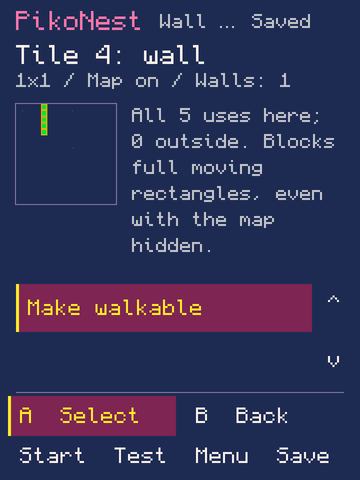
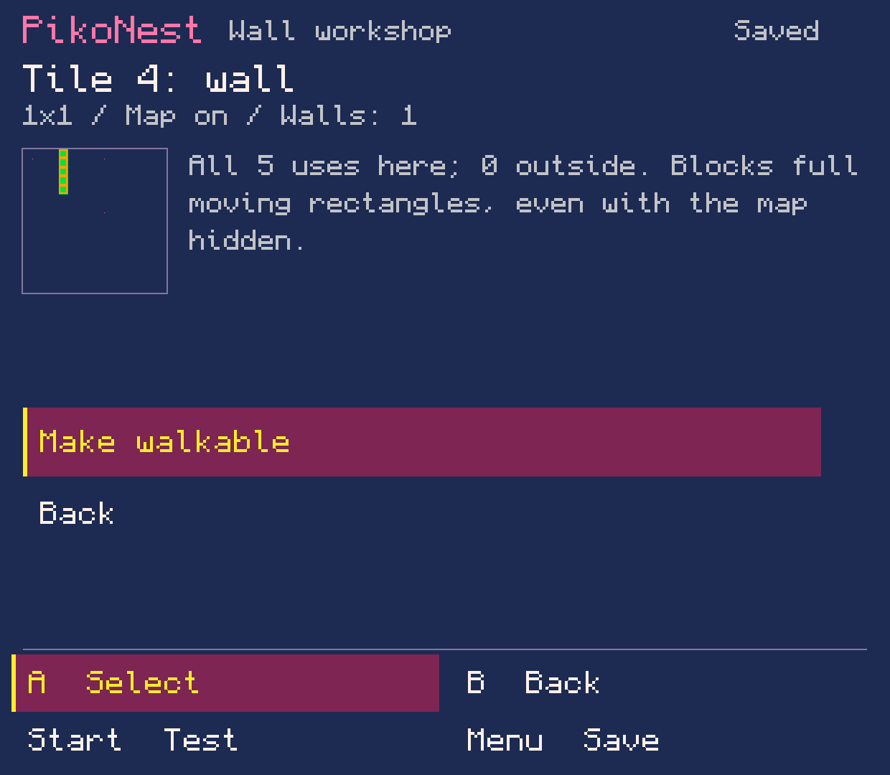
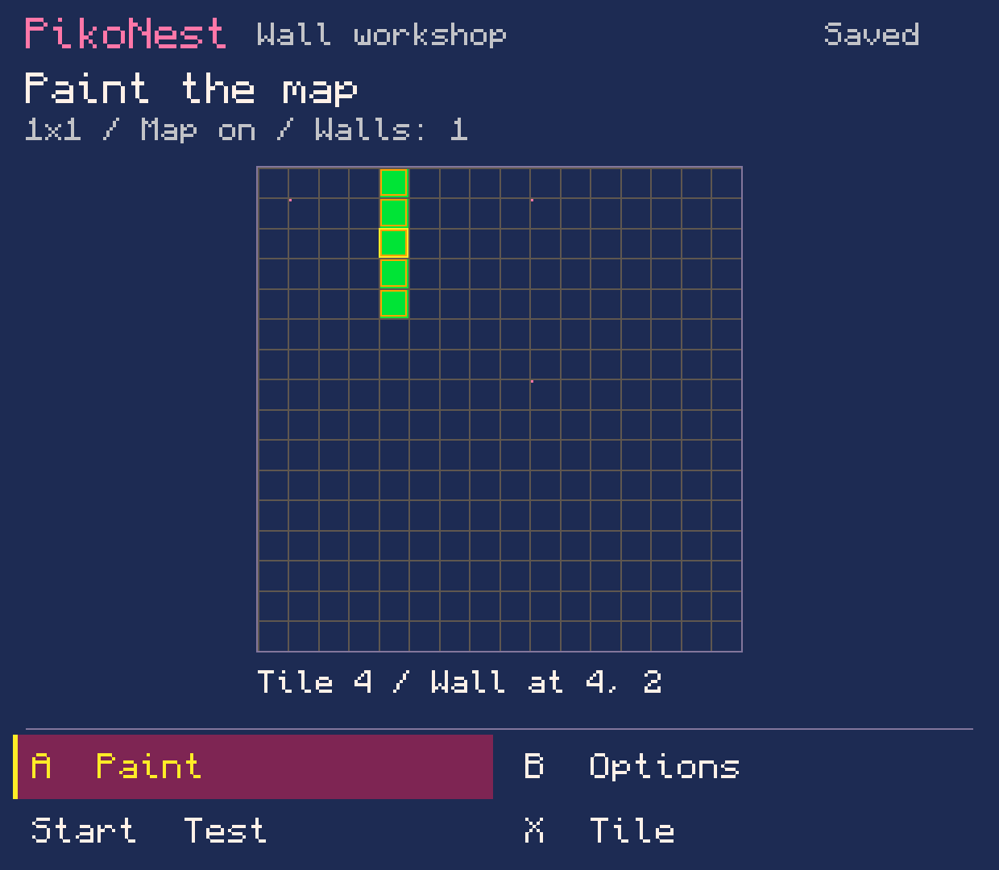

# Lab 0.0.94 — wall tiles in the workshop

Recorded 10 November 2026. This is a **local development build**, not a new public
release. The owner requested functional creation work first and said the handheld
is unavailable. No device was accessed, installed, launched or tested.

## What is implemented

From Game view, open **World & camera → Paint map**, select a non-empty map cell,
then **Options → Wall / walkable here → Make wall**. The tile picker also exposes
**X → Wall / walkable**. The review reports all placements inside and outside the
world. Orange outlines distinguish walls in the map and tile picker.

All configured moving elements use their full rectangular image bounds. Walls
stop motion at the tile edge while allowing sliding on the other axis. To make
one placement walkable, copy its tile through **Edit tile here → Make a tile copy**,
keep it, then make that copied type walkable. Copies initially keep wall behavior.

The world draft includes walls alongside map/art/camera changes. Test exports an
isolated current draft; Save makes one undoable edit. Cancel, failed-save retry,
reopen and source-checked journal recovery retain the same intent. Existing v1–11
journals are accepted; new journals use v12. Unknown or changed Lua is refused for
automatic editing. The standard `.p8` contains ordinary Lua and data.

## Checks actually run

- **92 core suites**, including **17,003 new workflow checks** (many are individual
  byte/pixel preservation assertions). The new test drives Blank authoring through
  existing actions: sprites, movement, contact rules, a goal, tile art and wall
  review, draft Test, failure/retry, Save/Undo/Redo, reopen and tile-copy edits.
- A real **v11 journal**, generated before implementation from beta-1 classes,
  retains dimensions, map cells, Undo and the original Back action focus.
- All sprite flags and lower shared graphics are preserved. Transparent wall types
  reserve resources for map-tile and Game view sprite/animation allocation.
- **Generated Lua execution in desktop Lua 5.4:** 8,706 checks for the ordinary map,
  8,711 with movement animation/music/event audio, and 8,706 with the map hidden.
  Includes walking around a wall, collection/win, hazard/loss, restart, four-sided
  collision, speeds 1–4, rectangular edges, exact partial moves, world boundaries,
  and seeded randomized rectangle sweeps. The harness expands `+=` and supplies
  a small PICO-8 API shim, including the real `sgn(0) == 1` behavior.
- Android source compilation: JDK 21.0.13, `--release 8`, SDK Platform 34.
- Production `GameSurface` rendered at 360×480, 620×540 and 960×540 with Java2D
  adapters. Compact review text and labels were corrected after inspection.
- Local integrated APK verification: signature, package/version, minimum API 26 /
  target 28, one launcher, 16 KiB native alignment, 263 Godot indexed assets,
  reviewed support hashes and exclusion of purchased runtime binaries/data.

The desktop Lua harness is **not official PICO-8**. It does not establish virtual
CPU/token/compression budgets, audio fidelity, Android lifecycle, SAF behavior or
physical controls. Native and owner acceptance remain open.

## Local APK

`PikoNest-0.0.94.apk`, version code 94, 52,110,545 bytes.

SHA-256: `0e03b21df3bf81a44727f51a424cc1781a69fdbc7cd79132d731380fffdfed45`.

The existing beta-1 signing certificate is retained. The file is ignored under
`.local/artifacts/`; it was **not installed or published**. Beta 1 remains the
public release, and a future release requires separate owner approval.

Packaging used the exact released beta-1 APK (SHA-256 `e496a14cc5751232850fa76b393f99ce9b5fb88668c9dbb6a8317ffc2cda224f`)
as the unchanged runtime/resource base. The complete current host/core/adapter Java
source was compiled; D8 36.0.0 generated replacement `classes2.dex`. Pinned Apktool
3.0.3 rebuilt the version metadata, then Build Tools 36 aligned and signed the APK.
This is a verified host-code replacement build, not a fresh native/runtime rebuild.
The initially available D8 34 failed internally on an existing enum class; using
the project's documented Build Tools 36 resolved it without source workarounds.

385 payload entries remain byte-identical. Four adaptive-icon XML files also
retain exact bytes; Apktool removed their redundant `-v26` path qualifiers while
minimum API 26 remained unchanged. Manifest, version resource table, host bytecode
and signatures are expected to differ. The runtime/support payload is unchanged.
[Machine-readable build identity](package.json) · [Validation/provenance](validation.json).

## Repeating the focused checks

The standard `experiments/android-host/build.ps1` now includes `WallWorkflowTest`.
With the repository core and test classes compiled to a class directory:

```text
java -cp CLASSES WallWorkflowTest REPOSITORY_ROOT
python3 experiments/android-host/tests/test_wall_lua.py .local/walls-work/evidence/maze.p8
python3 experiments/android-host/tests/test_wall_lua.py .local/walls-work/evidence/animated.p8
python3 experiments/android-host/tests/test_wall_lua.py .local/walls-work/evidence/hidden.p8
python3 experiments/host-preview/render.py --jdk JDK_ROOT --only WallPreview --output .local/walls-previews
```

The Python Lua check needs a Lua 5.4 shared library (`--lua-library` can name it).
It tests emitted code and never launches a runtime or touches a handheld.

## Original test carts and pictures

[Wall/collection cart](maze.p8), [animation/audio variant](animated.p8), and
[hidden-map variant](hidden.p8) are original automated test outputs. Simple artwork
and hidden flag/map sentinels are intentional preservation fixtures, not a new
starter template. Their gameplay has only been executed in the desktop harness.

**Host previews — not Android screenshots or gameplay captures:**







## Limits and next functional work

This is bounded top-down wall collision, with all moving elements affected and
per-tile-type rules. Tile zero is empty. Hiding the map keeps collision active.
Moving elements must begin inside the world and outside walls; invalid starts are
refused with an actionable message. Existing source data is retained.

There are no slopes, physics, one-way platforms, per-object collision masks,
switch-operated doors or general conversion of arbitrary Lua. The starting layout
remains a resource preview. Proposed next functional work: connect a switch to a
passage; official-runtime and physical verification wait for authorized device access.
