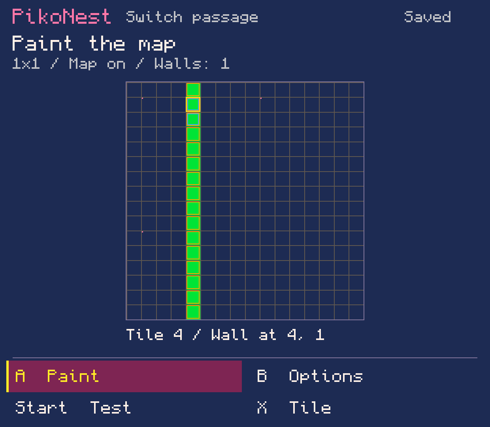
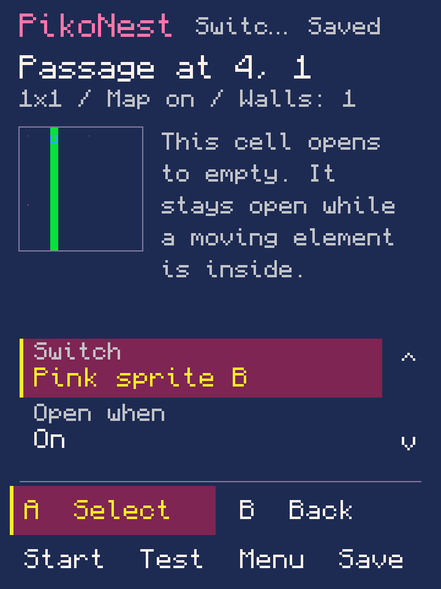
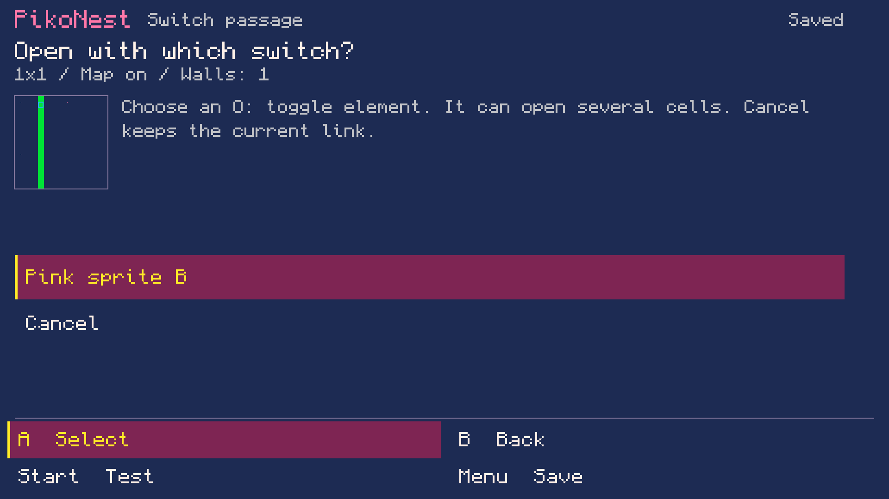

# Lab 0.0.95 — switch-operated passages

Recorded 10 November 2026. Local development work, not a public release. The
handheld is unavailable; no device was accessed, installed or launched.

## Implemented journey

Create a moving element and a toggle through the existing Game view tools. Paint
walls, then select a wall cell in **World & camera → Paint map → Options → Switch
passage here**. Choose the named switch and whether On or Off opens the cell.
Repeat for more cells; the current editor supports 32. Blue outlines mark links.

Open cells become empty. Other placements of the same tile remain walls. A closing
cell waits while any visible moving rectangle overlaps it; linked cells may close
independently. Restart reapplies the original switch states and map values. Initial
positions inside a passage are allowed only when it starts open. Global switch
selection still uses left/right + O and shares directions with movement; proximity
interaction and pressure plates are not implemented.

The world draft includes links, map, tile art and camera settings. Test exports an
isolated candidate; Save commits one undoable change. Failed saves retain the
draft. Picker cancel, 32-step draft history and interrupted recovery preserve
intent. New journals use v13 and still read v1–12. Real v11 and v12 fixtures cover
migration. Settings and animation recovery retain links, including an unfinished
Behavior change that must be corrected before saving.

Linked cells and switch targets require explicit unlinking before replacement or
removal; unrelated earlier-element deletion reindexes references. Shrinking past a
linked cell refuses before mutation. If All tools changes a linked map cell, the
passage page can remove its stale link without reverting the new map data.

Output is ordinary PICO-8 Lua with `mset` and existing wall collision. The saved
map retains closed tiles; changes occur in runtime RAM after movement and switch
input, before contacts/outcomes. Opening is visible in that update and traversable
on the next movement update. There is no added runtime/library dependency.
Unchanged no-passage carts keep exact previous source; unfamiliar Lua is preserved.
The [official manual](https://www.lexaloffle.com/dl/docs/pico-8_manual.html) describes
`mget`/`mset`, the default 128×32 map and tile zero's empty drawing behavior.

## Validation actually performed

- **93 local core suites passed**, including the new controller-action workflow.
  Focused follow-up after the final recovery/conflict fixes passed **17,235 checks**.
  Many count individual map/flag preservation assertions. Full suite names are in
  [core-suites.json](core-suites.json).
- The workflow starts from Blank: creates sprites, movement, toggle, win contact,
  tile art and walls, then links two cells. It covers isolated Test, failure/retry,
  Save/Undo/Redo, independent reopen, On/Off, target deletion/reindexing, resource
  conflicts, external-map repair, settings/animation recovery, invalid starts,
  32-cell limits/history, stale/truncated journals and unrecognized Lua refusal.
- **Five emitted cartridges executed in desktop Lua 5.4** using a small PICO-8 API
  shim: 94,267 assertions each for ordinary, hidden-map, inverted and starts-open
  variants; 94,269 with a second mover. Tests cover blocking, toggling/held input,
  crossing, delayed closure, other-cell preservation, win/restart and exhaustive
  rectangle-overlap sweeps at several image sizes. These counts describe host
  assertions, not official-runtime acceptance.
- The real pre-change v12 journal restores wall-review focus and Redo/Undo exactly.
  [Fixture provenance](../../../experiments/android-host/tests/fixtures/world-v12.md).
- All current Android/core/adapter Java sources compiled with JDK 21.0.13,
  `--release 8`, Android Platform 34. Production GameSurface was rendered via Java2D
  at 360×480, 620×540 and 960×540. Compact explanatory text and visible rows were
  corrected after inspection.
- Local APK checks: exact newly compiled host dex embedded; package version 95;
  one launcher; minimum API 26 / target 28; signing certificate matches beta 1;
  16 KiB native alignment; 263 indexed Godot assets; reviewed support hashes;
  no bundled purchased PICO-8 binaries/data.

Desktop Lua does not establish official PICO-8 syntax/runtime, fixed-point,
CPU/token/compression budgets or audio fidelity. Native Android lifecycle, SAF,
physical controls, novice usability and owner visual acceptance remain open.
Editor images show saved closed map data, not a running simulation.

## Local APK

`PikoNest-0.0.95.apk`, version code 95, 52,110,545 bytes.
SHA-256: `dd44ada60b78809d40c996c345d8a1a5bf0990090786e22f581499440da977fd`.
The ignored local artifact was not installed or published. The public release
remains 0.1.0-beta.1; its approval does not authorize a future APK release.

Packaging reused the exact reviewed beta-1 runtime/resource APK
(`e496a14cc5751232850fa76b393f99ce9b5fb88668c9dbb6a8317ffc2cda224f`). Complete
current host/core/adapter Java source was compiled, D8 36 generated the replacement
host dex, pinned Apktool 3.0.3 rebuilt version metadata, and Build Tools 36 aligned
and signed it using the existing development certificate. This is a host-code
replacement build, not a new native/runtime rebuild.

385 payload entries remain byte-identical to beta 1. Four adaptive-icon XML files
retain exact bytes with redundant `-v26` path qualifiers removed by Apktool, as in
lab 0.0.94. Manifest, version resource table, host dex and signatures differ.
[Package identity](package.json) · [Validation/source hashes](validation.json).

## Reproduce

The standard `experiments/android-host/build.ps1` includes `PassageWorkflowTest`.
With the repository core and tests compiled:

```text
java -cp CLASSES PassageWorkflowTest REPOSITORY_ROOT
python3 experiments/android-host/tests/test_passage_lua.py .local/passages-work/evidence/switch-passage.p8
python3 experiments/android-host/tests/test_passage_lua.py .local/passages-work/evidence/starts-open.p8
python3 experiments/android-host/tests/test_passage_lua.py .local/passages-work/evidence/inverse.p8
python3 experiments/android-host/tests/test_passage_lua.py .local/passages-work/evidence/hidden.p8
python3 experiments/android-host/tests/test_passage_lua.py .local/passages-work/evidence/two-movers.p8
python3 experiments/host-preview/render.py --jdk JDK_ROOT --only PassagePreview --output .local/passages-previews
```

The Python harness requires a Lua 5.4 shared library; `--lua-library` can name it.
It expands generated `+=` syntax and supplies the required API shim, including
PICO-8's `sgn(0) == 1`. It never starts official PICO-8 or accesses a handheld.

## Original test artifacts

[Switch passage](switch-passage.p8) · [Starts open](starts-open.p8) ·
[Open when Off](inverse.p8) · [Hidden map](hidden.p8) · [Two movers](two-movers.p8).
These are original automated outputs with deliberately minimal test artwork,
not purchased cartridges or a finished game/template library.

The images below use production view code with Java2D adapters and the exported
test cart. They are **host previews, not Android screenshots or device acceptance**.






