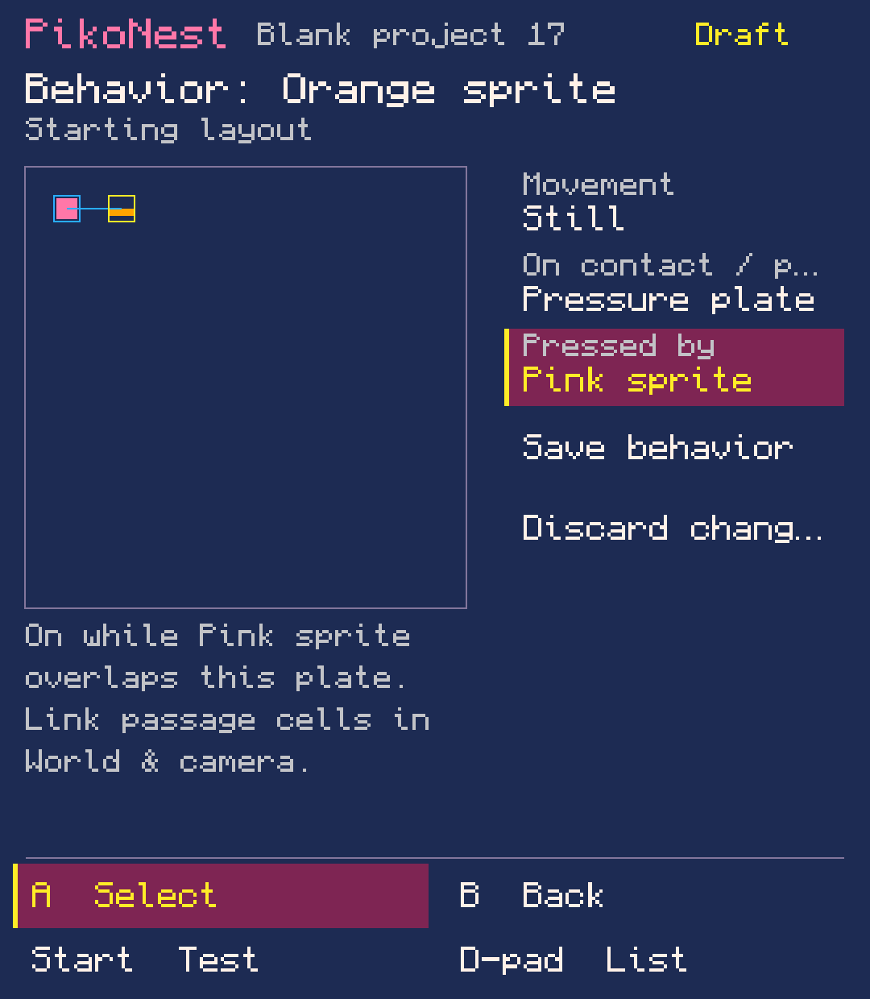
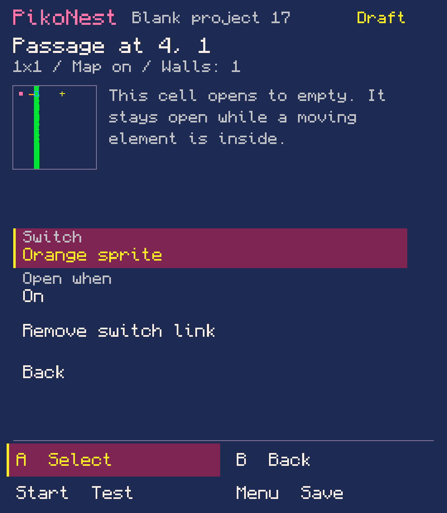
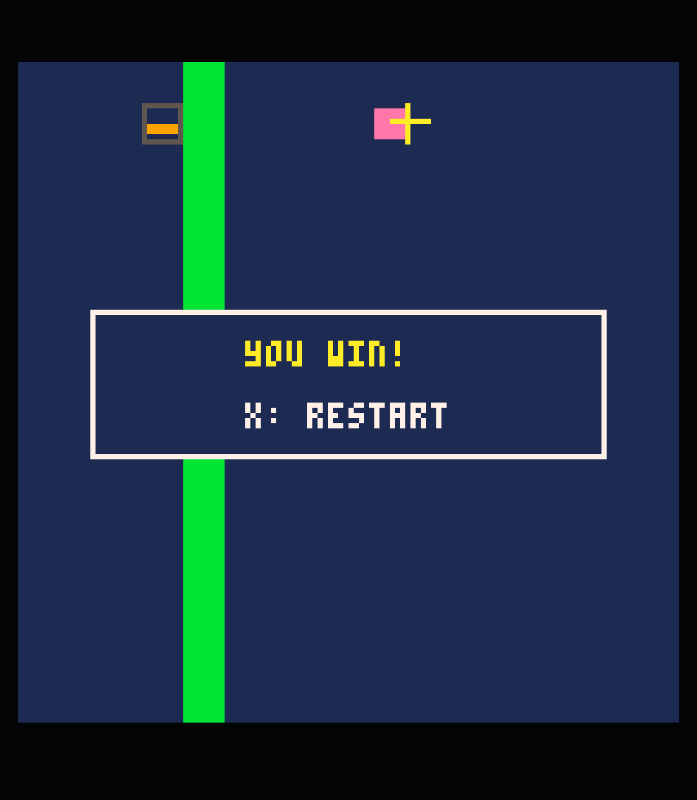

# Beta 2 — native pressure-plate journey

Captured 11 November 2026 from the final 0.1.0-beta.2 APK on Retroid Pocket Classic,
Android 14, 1080 × 1240. These are unmodified Android screenshots, not host previews
or mockups. Input was injected through ADB; no physical or audible acceptance is
claimed. Only original test artwork/cartridges are shown. PikoNest original artwork
and sample carts follow the repository MIT license; PICO-8 retains its own terms.

| Capture | What it demonstrates |
| --- | --- |
| [01-pressure-plate.png](01-pressure-plate.png) | Native Behavior draft with the selected activator. |
| [02-passage-link.png](02-passage-link.png) | One wall cell linked to the plate, opening when On. |
| [03-world-review.png](03-world-review.png) | Returned draft with combined map/art/wall/passage review. |
| [04-exported-game-win.png](04-exported-game-win.png) | Independently launched UI-authored export wins in official PICO-8. |
| [05-export-verified.png](05-export-verified.png) | SAF write/readback equals the saved cartridge. |
| [06-official-probe.png](06-official-probe.png) | Separate diagnostic cartridge passes 13 semantic checks. |

[Exact journeys, cart download and limits](../../release/beta2/DEVICE_ACCEPTANCE.md).
